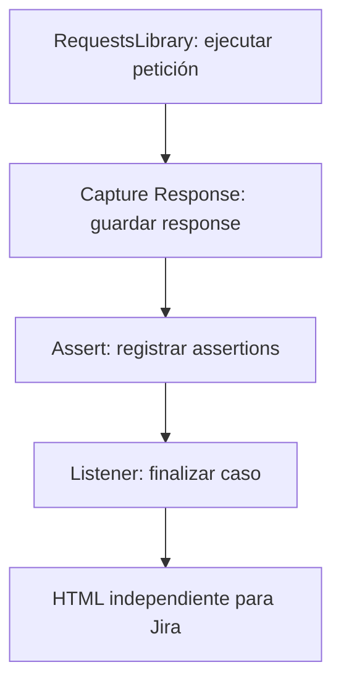

<section class="er-report-explanation" markdown>

## El estado es una parte. El contenido completa la historia.

Una respuesta HTTP 200 puede contener un dato que incumple la validación. Request Reporter
reúne la petición, la respuesta y las assertions para que puedas leer el resultado con
su contexto. La portada interpreta el título vacío de un caso ficticio de libros.
El HTML de abajo es el archivo real generado por la herramienta.

</section>

## Captura. Valida. Comparte.

- **01 · Capture Response**

    Conserva el intercambio HTTP junto a su caso de prueba.

- **02 · Assert**

    Asocia cada validación con su petición correspondiente.

- **03 · HTML**

    Comparte un reporte independiente, listo para abrir sin conexión.

<section id="report-preview" class="er-real-report" aria-labelledby="report-preview-title" markdown>

<h2 id="report-preview-title">El reporte, tal como se genera</h2>

Tres peticiones, cuatro validaciones aprobadas y un fallo intencional. Abre **Fallos**
y selecciona **Book title must contain a value** para llegar a **Consult book** y su
assertion exacta. También puedes [abrir el reporte completo](examples/books.es.html).

<iframe src="examples/books.es.html" title="Reporte HTML real del caso de libros en español" loading="lazy"></iframe>

[Descargar el caso de prueba](examples/book-example.zip){ download }

HTML autónomo. Listo para abrir sin conexión.

</section>

## Qué necesitas

| Herramienta | Compatibilidad |
|---|---|
| Python | 3.12 o superior |
| Robot Framework | 7.5 o superior, rama 7.x |
| RequestsLibrary | Ejecuta las peticiones; se instala aparte |
| DataDriver | Opcional, genera los casos a partir de datos |

## Cómo funciona

Solo se incluyen los intercambios que capturas explícitamente. Importar la librería
registra su listener: no necesitas un argumento CLI ni una keyword de generación.

!!! tip "Los metadatos son opcionales"
    Puedes agregar entorno, identificador o fila de datos para dar contexto.
    El reporte funciona sin ellos y sin un título adicional.

## Elige tu recorrido

- **Primer uso:** [instalar](installation.md) y [ejecutar un caso](usage.md).
- **Datos tabulares:** [generar casos con DataDriver](datadriver.md).
- **Revisar resultados:** [leer Summary, Failures y Assertions](report.md).
- **Consultar argumentos:** [referencia Libdoc](keywords/index.html).
- **Probar el proyecto completo:** [ejemplo ejecutable](https://github.com/angel-valdezzz/robotframework-api-testing/tree/main), con Poetry y una API local ficticia.

También puedes abrir un [reporte aprobado sin metadatos](examples/passing.html). Cada ejemplo es un
archivo de un solo caso. No existe un dashboard que reúna toda la suite.
